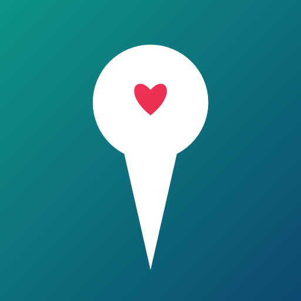

# Mappo

[](LICENCE)
[](sw.js)
[](manifest.webmanifest)

Web App installabile (PWA) per salvare i tuoi posti preferiti, vederli sulla mappa e ritrovarli in un attimo. Pensata per il telefono, funziona anche offline.

- Repository: <https://github.com/Voboz/Mappo>
- Demo: <https://voboz.github.io/Mappo/>
- Informativa privacy: [PRIVACY.md](PRIVACY.md)



## Cosa sa fare

- **Salva i luoghi** con nome, categoria, nota, preferito, stato e posizione (GPS, mappa o link Google Maps).
- **Mappa OpenFreeMap** con un pin colorato e icona per ogni categoria.
- **Menu laterale** con tutti i luoghi, filtri per categoria, preferiti, da visitare e visitati, con conteggi.
- **Vicino a me**: chiede la posizione, mostra la distanza di ogni luogo e ordina dal più vicino; un secondo tocco ripristina l'ordine alfabetico.
- **Ricerca per nome** (cerca anche in note, indirizzo e categoria) con evidenziazione del risultato.
- **Navigazione** verso un luogo con **Waze** o **Google Maps**.
- **Posizione attuale** con indicatore preciso e distanze nella lista.
- **Categorie personalizzate** con colore e icona (oltre alle 8 predefinite).
- **Esporta** in JSON, GeoJSON, KML, GPX o CSV, con nome, categoria, nota, preferito e stato.
- **Importa** da JSON, GeoJSON, KML, GPX e CSV, inclusi i file di Google Takeout. Anteprima prima di confermare, duplicati saltati e geocodifica automatica dei CSV senza coordinate.
- **Condividi** la lista come file (menu di condivisione del telefono, con download come riserva) o come link compresso: chi lo apre vede un'anteprima e sceglie se importare.
- **Ricevi luoghi condivisi** da Google Maps o da un'altra app: il luogo arriva nel form "Nuovo luogo" già precompilato, con il punto sulla mappa, e confermi tu prima di salvare.
- **Installabile** sulla schermata Home e **offline** per l'interfaccia e le zone di mappa già visitate.
- **Dati solo sul telefono**: nessun account e nessun server dell'autore; nessun cookie, analytics o pubblicità. Dettagli nell'[informativa privacy](PRIVACY.md).

## Avvio rapido sul PC

Serve Python 3.

```bat
avvia-server.bat
```

Oppure da terminale:

```bash
python -m http.server 8080
```

Poi apri <http://localhost:8080>.

> Nota: aprendo `index.html` con doppio clic l'app funziona, ma il service worker e l'installazione PWA richiedono `http://localhost` oppure HTTPS.

## Installarla sul telefono

Per installare una PWA Chrome richiede un indirizzo **HTTPS** (oppure `localhost`). Il modo più semplice è pubblicare il progetto su un hosting statico gratuito.

### Opzione A — GitHub Pages (consigliata)

Il progetto è già su GitHub: <https://github.com/Voboz/Mappo>.

1. Se non hai un account, creane uno su [github.com](https://github.com).
2. Apri il repository <https://github.com/Voboz/Mappo> → **Settings → Pages**.
3. In *Branch* scegli `main` e cartella `/root`, poi **Save**.
4. Dopo circa un minuto l'app sarà su `https://voboz.github.io/Mappo/`.
5. Apri quel link con **Chrome** sul telefono, tocca il menu **⋮ → Installa app** (o *Aggiungi a schermata Home*).

### Opzione B — Netlify Drop

1. Vai su <https://app.netlify.com/drop> e accedi (gratis).
2. Trascina la cartella del progetto nella pagina.
3. Apri il link `https://…netlify.app` sul telefono e installa da Chrome.

### Opzione C — solo per provare (senza installazione)

Avvia `avvia-server.bat` sul PC, collega telefono e PC alla stessa rete Wi-Fi e apri sul telefono:

```
http://IP_DEL_PC:8080
```

L'app funziona, ma senza HTTPS Chrome non permette l'installazione completa né la cache offline. Lo script mostra l'indirizzo IP corretto all'avvio.

## Guida d'uso

- **Aggiungere un luogo**: tocca il **+**, oppure **tieni premuto** su un punto della mappa.
- **Scegliere la posizione**: “Posizione attuale”, “Scegli sulla mappa” (sposta la mappa e conferma) o incolla un link Google Maps.
- **Preferiti e stato**: nel form tocca la stella e scegli lo stato; nella lista puoi cambiare entrambi al volo.
- **Ritrovare un luogo**: apri il menu ☰, cerca per nome o filtra per categoria, preferiti, da visitare e visitati, tocca il luogo per volare sulla mappa.
- **Vicino a me**: nel menu ☰ tocca **Vicino a me**: l'app chiede il permesso di posizione, calcola la distanza (formula Haversine) e ordina i luoghi dal più vicino. Tocca di nuovo **Più vicini** per disattivare l'ordinamento e tornare all'ordine alfabetico. Se il permesso viene negato o la posizione non è disponibile, un messaggio spiega cosa fare.
- **Navigare**: apri il pin → **Waze** o **Google Maps**.
- **Modificare/eliminare**: apri il pin → Modifica / Elimina (con annullamento).
- **Esportare**: menu ☰ → **Esporta** e scegli il formato (JSON, GeoJSON, KML, GPX, CSV).
- **Importare**: menu ☰ → **Importa** e scegli un file JSON, GeoJSON, KML, GPX o CSV. L'app mostra un'anteprima: puoi unire ai luoghi esistenti o sostituirli. I duplicati (stesso nome e coordinate entro 60 m) vengono saltati.
- **CSV senza coordinate**: se il file non contiene latitudine e longitudine (tipico delle liste di Google Takeout), l'app cerca ogni luogo con Nominatim, una richiesta al secondo. A fine importazione mostra quanti luoghi sono stati importati, duplicati o saltati.
- **Condividere**: menu ☰ → **Condividi**. Scegli **Condividi un file** (stessi formati dell'export: sui dispositivi compatibili si apre il menu di condivisione, altrimenti il file viene scaricato) oppure **Condividi un link**, che comprime i luoghi nell'URL. Chi apre il link trova l'anteprima e può unire o sostituire i suoi luoghi. Se la lista è troppo grande per un link, l'app propone la condivisione via file.
- **Ricevere un luogo**: in Google Maps (o in un'altra app) tocca **Condividi** e scegli **Mappo**. L'app estrae il nome e l'indirizzo dal testo condiviso: se il link contiene le coordinate le usa subito, se è un link breve lo risolve, altrimenti cerca il nome con Nominatim. Il form "Nuovo luogo" si apre già compilato con il punto sulla mappa; controlla e conferma tu. Se non riesce a riconoscere il luogo, mostra il testo ricevuto e ti fa scegliere il punto a mano.

### Link Google Maps supportati

Sono riconosciuti i link completi (`google.com/maps/place/...`, `?q=lat,lng`, `@lat,lng`, `!3d…!4d…`), le coordinate `45.4642, 9.1900`, i link `geo:` e i **link brevi** (`maps.app.goo.gl`, `goo.gl/maps`, `g.co/maps`). Se il link contiene solo il nome del luogo (`?q=Piazza+Navona,+Roma`), l'app lo cerca con Nominatim.

I link brevi non contengono le coordinate: le ha solo la pagina di destinazione, e il browser non può leggerle (Google non invia header CORS e il redirect resta opaco). L'app li fa quindi seguire dal **Worker Mappo** su Cloudflare (`mappo-link.mappo.workers.dev`), che legge l'header `Location` del redirect e restituisce l'URL finale senza scaricare la pagina di Maps. Il Worker è incluso nel repository: [`worker/link-resolver.js`](worker/link-resolver.js).

Se `SHORT_LINK_ENDPOINT` in `app.js` viene svuotato, i link brevi non vengono più risolti: l'app non contatta più servizi pubblici. Per riattivarli va reintrodotto un resolver compatibile e aggiunto il suo dominio a `connect-src`.

Lo stesso vale per un link breve dentro un file importato (colonna `url` di CSV/GeoJSON), con un tetto di 10 link per file.

**Privacy**: solo il link breve viene inviato al Worker, e soltanto quando c'è da risolverlo (i link completi non escono mai dal dispositivo). Il Worker non usa cookie, non legge il contenuto delle pagine e non conserva i link. Se preferisci non dipendere nemmeno dal Worker pubblico, deploya il tuo e cambia `SHORT_LINK_ENDPOINT` e la CSP.

#### Worker Cloudflare

L'istanza pubblica dell'app usa già `https://mappo-link.mappo.workers.dev/`. Per usarne una tua:

1. Crea un Worker su <https://dash.cloudflare.com/> (**Workers & Pages → Create → Worker**) e incolla il contenuto di `worker/link-resolver.js`.
2. Fai **Deploy** e copia l'indirizzo, per esempio `https://mappo-link.tuonome.workers.dev/`.
3. Consigliato: in **Settings → Variables** imposta `ALLOWED_ORIGIN` con le origini dell'app separate da virgola (es. `https://voboz.github.io,http://localhost:8080`) per limitare chi può chiamarlo.
4. In `app.js` sostituisci `SHORT_LINK_ENDPOINT` con quell'indirizzo e aggiorna il dominio in `connect-src` dentro `index.html`.

Istruzioni dettagliate (anche con `wrangler`): [`worker/README.md`](worker/README.md). Il Worker accetta solo host Google e percorsi `/maps/`: non è un proxy aperto.

> **Nota sull'hosting.** Su un'origine condivisa (per esempio `*.github.io`) tutte le app dello stesso account condividono l'origine e quindi anche il `localStorage`. Se pubblichi dati sensibili, usa un dominio dedicato.

## Struttura del progetto

```
index.html               interfaccia
styles.css               stile e animazioni
app.js                   logica (mappa, dati, ricerca, export e condivisione)
manifest.webmanifest     manifest PWA
sw.js                    service worker (offline)
LICENCE                  licenza del codice dell'app (PolyForm Noncommercial 1.0.0)
PRIVACY.md               informativa privacy
vendor/leaflet/          Leaflet 1.9.4 incluso in locale
vendor/maplibre/         MapLibre GL JS 5.24.1 e plugin Leaflet incluso in locale
vendor/VERSIONS.md       versioni e licenze delle librerie incluse
worker/                  Worker Cloudflare facoltativo per i link brevi
icons/                   icone app
tools/make-icons.ps1     rigenera le icone
avvia-server.bat         server locale di prova
robots.txt               regole per i crawler
.gitignore               esclude archivi locali e file di lavoro
```

> Gli archivi locali (per esempio `mappo.zip`) non vanno pubblicati: `.gitignore` li esclude già.

## Note tecniche

- **Mappe**: stile vettoriale OpenFreeMap (OpenMapTiles/OpenStreetMap) con attribuzione obbligatoria. Per un uso intensivo o commerciale valuta un'istanza dedicata o il self-hosting.
- **Dati**: `localStorage` del browser. Cancellando i dati del sito si perdono i luoghi: usa l'export. Le chiavi sono volutamente quelle del vecchio nome (`ldc.*`): cambiarle farebbe perdere i luoghi già salvati.
- **Importazione**: massimo 5 MB e 5000 voci per file; i duplicati (stesso nome entro 60 m) vengono saltati.
- **Indirizzi**: geocodifica inversa tramite Nominatim (OpenStreetMap) solo quando serve, con richieste limitate a circa una al secondo.
- **Offline**: interfaccia e tessere già caricate restano disponibili; le zone mai visitate richiedono connessione. Stile, TileJSON, sprite e font della mappa non vengono mai sfrattati dalla cache.
- **Export CSV**: le celle che iniziano con `=`, `+`, `-` o `@` vengono prefissate con un apostrofo, così i fogli di calcolo non le interpretano come formule.
- **Link condivisi**: i dati sono compressi, **non cifrati**: chi possiede il link può leggerli. Il token sta nel frammento (`#`), quindi non finisce nei log del server.
- **Licenza Leaflet**: BSD-2-Clause, vedi `vendor/leaflet/LICENSE.txt`.
- **Licenza MapLibre GL JS**: BSD-3-Clause, vedi `vendor/maplibre/LICENSE.txt`.
- **Licenza plugin Leaflet-MapLibre**: ISC, vedi `vendor/maplibre/LICENSE-plugin.txt`.

## Privacy

Mappo non ha account, backend, cookie, analytics o pubblicità. I luoghi, le note e le categorie restano nel `localStorage` del dispositivo e non vengono inviati all'autore.

Escono dal dispositivo solo le richieste tecniche necessarie:

- tessere della mappa verso **OpenFreeMap** (IP e zona visualizzata);
- indirizzi e coordinate verso **Nominatim/OpenStreetMap**, quando salvi un indirizzo o importi un CSV senza coordinate;
- il solo **link breve** verso il **Worker Mappo** su Cloudflare, e solo quando serve;
- i log tecnici del fornitore di hosting, se pubblichi l'app.

In-app: **Info → Privacy** riporta la sintesi, consultabile anche offline. Il testo completo è in [PRIVACY.md](PRIVACY.md). I dati si cancellano con **Info → Cancella tutti** (luoghi) o cancellando i dati del sito dal browser (anche impostazioni e cache); l'export serve come copia portabile.

Per un uso pubblico o professionale fai verificare l'informativa da un consulente: il testo descrive il funzionamento dell'app, ma non sostituisce una consulenza legale.

## Licenza

Il codice di questa app è concesso sotto **[PolyForm Noncommercial License 1.0.0](LICENCE)** (<https://polyformproject.org/licenses/noncommercial/1.0.0>): puoi usarlo, modificarlo e ridistribuirlo per scopi **non commerciali** (uso personale, hobby, enti senza scopo di lucro, ricerca, istruzione).

> Required Notice: Copyright Voboz (https://github.com/Voboz/Mappo)

**Cosa significa in pratica**

- Puoi usare l'app liberamente per te, per studi, per progetti amatoriali e per organizzazioni non commerciali.
- **Non puoi** vendere il codice, né usarlo in un prodotto o servizio a scopo di lucro (per esempio dentro un'app a pagamento o per un cliente commerciale).
- Puoi creare versioni modificate: le "Changes and New Works License" lo permettono, purché resti un uso non commerciale.
- Chi riceve una copia del software deve ricevere anche la licenza: per questo il file `LICENCE` è nella radice del repository.
- Il link di questa pagina e il file `LICENCE` valgono come copia dei termini.

Le librerie di terze parti in `vendor/` **non** sono coperte da questa licenza: mantengono le proprie licenze (BSD-2-Clause, BSD-3-Clause, ISC), riportate in `vendor/VERSIONS.md`.

## Aggiornare l'app

Dopo aver modificato i file e ripubblicato, cambia `VERSION` in `sw.js` (es. da `v1.0.2` a `v1.0.3`): così i dispositivi scaricano la nuova versione. Quando la nuova versione è pronta compare l'avviso “Nuova versione disponibile”: tocca **Ricarica** per attivarla subito, altrimenti verrà usata alla prossima apertura.

---

Versione 1.6.8 · Mappo · i luoghi restano salvati solo sul tuo dispositivo; mappa OpenFreeMap, indirizzi tramite Nominatim/OpenStreetMap.
